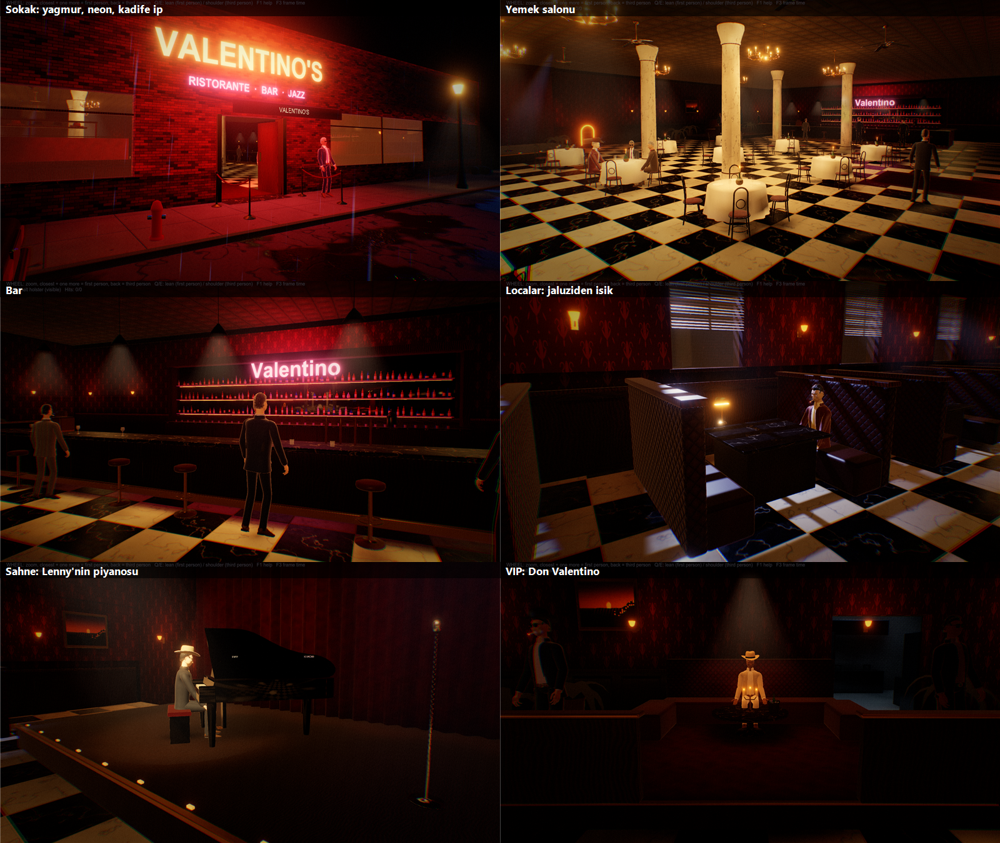
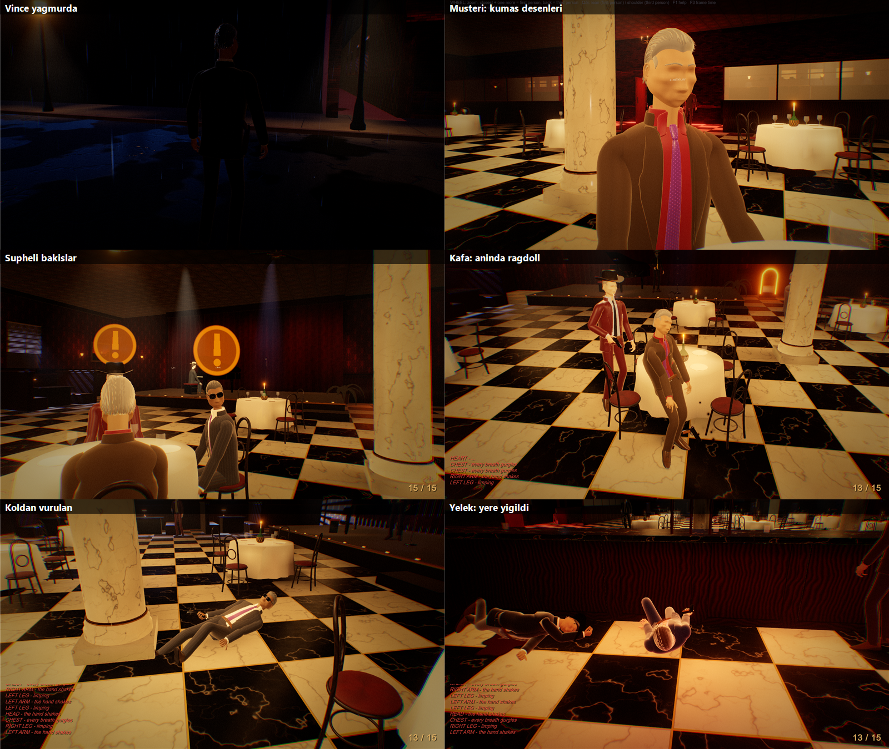

# VinceNoir — Valentino's

Yağmurlu bir gece, 1994, Little Italy. Dedektif **Vince "Slim" Walker**, bir pistol ve mafya dolu bir bar-restoran.
Unity 6 (Built-in RP) ile yapılmış üçüncü/birinci şahıs bir noir oyunu. Karakter Blender'da Python ile prosedürel üretildi; sahneler, malzemeler, ışıklar ve botlar Unity editör script'leriyle kuruluyor.




---

## Gereksinimler

| Ne | Sürüm | Not |
|---|---|---|
| **Unity** | **6000.6.3f1** (Unity Hub ile kur) | Windows Build Support modülü yeterli |
| Windows | 10/11 | Build DX11 kullanır |
| Blender | 5.x (5.2 ile yapıldı) | **İsteğe bağlı** — sadece karakteri / animasyonları değiştireceksen |
| GitHub Desktop (veya git) | — | Depoyu klonlamak için |

## Başka bir bilgisayarda açmak

1. **Klonla:** GitHub Desktop → *File › Clone repository* → `VinceNoir` → kısa bir yol seç (ör. `C:\UnityProjects\VinceNoir`).
2. **Unity Hub** → *Add › Add project from disk* → klonladığın klasör. Hub doğru sürümü (6000.6.3f1) ister; kurulu değilse kurdurur.
3. Projeyi aç. İlk açılışta `Library` yeniden oluşur (birkaç dakika sürer, normal).
4. **Project** penceresinde `Assets/VinceNoir/Scenes/BarValentino` sahnesini aç → **Play**.
   - Sahne, ışık haritaları (lightmap), light probe'lar ve occlusion verisi depoda hazır gelir.
5. "Kurulum eski kalmış" diye bir pencere çıkarsa **Şimdi kur**'a bas, ya da üst menüden **VinceNoir › 1. Setup Everything**.
   - Bu adım her şeyi baştan üretir: model import ayarları, animator'lar, malzemeler, iki sahne, ışık bake'i. Yaklaşık 1 dakika sürer.
6. Oyunun exe'sini almak için: **VinceNoir › 2. Build Windows Player** → `Builds/VinceNoir.exe`. Build klasörü depoda yok, her makinede yeniden üretilir.

> Sahneler editör script'leriyle **üretilir**. Sahneyi elle düzenlersen bir sonraki *Setup Everything* üzerine yazar.
> Kalıcı değişiklik için ilgili editör script'ini değiştir (bkz. [Proje yapısı](#proje-yapısı)).
> Inspector'da atadığın ses dosyaları (ateş, reload, boş tetik, kılıf, çakmak...) kurulumda korunur.

## Kontroller

| Tuş | İş |
|---|---|
| WASD / Shift / Space / Ctrl | yürü / koş / zıpla / çömel |
| **C bir kez** | gizli, yavaş çekiş (bel: el silahta · omuz: kemer hizasında saklı · sırt: arkada tutar) / gizliyse yerine koy |
| **C iki kez** | normal çekiş · silah eldeyken C = kılıfa koy |
| Sağ tık | nişan / zoom (gizliyken: hızlı çekiş) |
| Sol tık / R | ateş / şarjör değiştir |
| 1 / 2 / 3 | taşıma: bel / omuz kılıfı / sırt (silah kılıftayken) |
| Fare tekeri | zoom; en yakında bir tık daha = birinci şahıs, geri = üçüncü şahıs |
| Q / E | birinci şahısta eğilme (silah yamulur, isabet düşer) · üçüncü şahısta omuz değiştir |
| P | sigara yak / at (silah eldeyken sol el ağızdan alıp fırlatır) |
| **H (basılı)** | turnike (kesik atardamar kanamasını durdurur) |
| F1 / F3 / Esc | kontrol listesi / FPS göstergesi / imleç |

## Oyun sistemleri (kısaca)

- **Tehlike:**
  - Kapıcı görünen silahı kapıda alır, çıkarken geri verir.
  - İçeride silahı elinde gören bot önce sarı, sonra turuncu, sonra kırmızı ikaz verir ve alarm başlar. Silahı hemen saklarsan bir şey olmaz.
- **Botların yaraları (can barı yok):**
  - Kafa: anında ölüm (ragdoll, sonra vücut kaskatı kalır).
  - Boyun: omurilik ise anında ölüm, atardamar ise saniyeler içinde.
  - Kalp: birkaç saniye sendeler, sonra yığılır.
  - Akciğer: %50 savaş dışı kalır ve 3 dk içinde ölür; %50 sendeleyerek 1 dk daha savaşır, sonra yığılır ve 2 dk içinde ölür.
  - Karın: çoğu savaş dışı kalır.
  - Kol ya da bacak: acıyla yere düşer, sonra rastgele bir sonuç gelir (yerde kalır / diğer kolla ya da siperden oturarak savaşır / kaçar). Üst kol ve uylukta atardamar kesilmesi ihtimali var.
- **Çelik yelek:**
  - Sadece göğsü korur; karın ve boyun açıkta.
  - 1. isabet: 3 sn yerde kalır, sonra yavaş ve titrek savaşır.
  - 2. isabet: %50 ihtimalle 6 sn yerde kalıp daha kötü savaşır; %50 ihtimalle savaşı bırakır.
  - 3. isabet: kesin savaş dışı.
- **Vince'in yaraları:**
  - Kafa: anında ölüm. Kalp: saniyeler. Akciğer: ~1,5 dk. İkinci gövde yarası: saniyeler.
  - Kol: nişan titrer, sol kol vurulursa tek elle ateş eder. Bacak: topallar, koşamaz.
  - Atardamar kesilirse **H** ile turnike sarılır.
  - Can barı yok; ekran kan kaybıyla daralır ve renk kaybeder.
- **Bot yapay zekâsı:**
  - Gerçek mermiler atar (nişan sapmalı ışınlar): siper ve eğilme gerçekten korur, dost ateşi mümkündür.
  - Şarjör değiştirir, yakından geçen mermiyle sinip bastırılır, siper arar, cesur olanlar yandan dolanır.
  - Aynı anda en fazla 2 bot ateş eder.

## Proje yapısı

```
Assets/VinceNoir/
  Editor/            Kurulum (sahneleri, malzemeleri, animator'ları, ışıkları ÜRETEN kod)
    VinceSetup.cs        menü (Setup / Build / Custom Animations), model import, Vince'in animator'ı, sokak (antrenman) sahnesi, oyuncu
    VinceBarSetup.cs     bot animator'ı, botlar (görünüm, ragdoll/hitbox), yönetmen, Vince'in bardaki yeri
    VinceBarScene.cs     Valentino's: sokak, cephe, salon, bar, localar, sahne, VIP, mutfak, ışıklar, bake, probe'lar, occlusion
    VinceArt.cs          prosedürel dokular (mermer, damask, ahşap, kumaş desenleri, tablolar...) + mesh araçları
    VinceProps.cs        mobilya / dekor mesh'leri (sandalye, piyano, avize, sedan, fötr şapka...)
    VinceSetupCheck.cs   açılışta "kurulum eski mi?" kontrolü
    VinceAudioTrimmer.cs ses kırpma aracı (menü 4)
  Scripts/           Oyun kodu
    VincePlayer.cs       hareket, kamera bağlantısı, silah (çekiş/kılıf/gizli taşıma, nişan IK, ateş, reload), ceket, test
    PlayerHealth.cs      Vince'in yaraları, kanama, turnike, ölüm ekranı
    MafiaBot.cs          bot: şüphe, savaş, siper, gerçek mermi, yara kuralları, yelek, ragdoll
    BarDirector.cs       navmesh, siper noktaları, alarm, kapıcı, bastırma, kan/kurşun izleri, otomatik testler
    BarAmbience.cs + JazzSynth.cs   yağmur, piyano (prosedürel caz), bardak sesleri, araba farları, sis
    NoirPostFX.cs        kamera efektleri (bloom, ton, renk, vinyet, gren, yara efektleri)
    TPCamera.cs, VinceSmoking.cs, Footsteps.cs, ShellCasings.cs, BlobShadow.cs, PerfProbe.cs, ...
  Shaders/           Character (kumaş/deri), PostFX, LightShaft, BlobShadow, NeonText
  Models/            Vince_Slim_Walker_Animated.fbx (Blender'dan)
  Animations/Custom/ Mixamo animasyon slotları (Idle, Walk, Run, Strafe..., README.txt)
  Audio/             senin ses dosyaların
  Scenes/            BarValentino (+ ışık verisi), NoirTest (antrenman sokağı)
  Materials/ Textures/ Meshes/ Animation/   kurulumun ürettiği varlıklar
Blender/             karakterin kaynağı (aşağıya bak)
Tools/               BuildAndTest.ps1, BlenderExport.ps1
docs/screenshots/    ekran görüntüleri
```

## Karakteri / animasyonları değiştirmek (Blender)

- `Blender/build.py` → `Vince_Slim_Walker.blend` — karakterin kendisi (mesh, malzeme, iskelet, ağırlıklar).
- `Blender/anim.py` → `Vince_Slim_Walker_Animated.blend` + `.fbx` — tabanca parçaları, tüm oyun klipleri, birleştirilmiş mesh'ler + LOD'lar, kumaş UV'leri.
- `Blender/render.py` — tanıtım görselleri (`Blender/renders/`). `export.py` — animasyonsuz FBX.

```powershell
.\Tools\BlenderExport.ps1             # anim.py çalıştır, FBX'i Assets/VinceNoir/Models'e kopyala
.\Tools\BlenderExport.ps1 -Model      # önce karakteri (build.py) de yeniden üret
.\Tools\BlenderExport.ps1 -Preview    # + poz önizleme sayfası
```
Sonra Unity'de **VinceNoir › 1. Setup Everything**.

## Build ve otomatik testler (Unity kapalıyken)

```powershell
.\Tools\BuildAndTest.ps1                              # Setup Everything + build
.\Tools\BuildAndTest.ps1 -Step build                  # sadece build (kod değiştiyse)
.\Tools\BuildAndTest.ps1 -Step none -Test autotest    # bar: çekişler, kapı, şüphe, alarm, ateş, tüm yara kuralları + ekran görüntüleri
.\Tools\BuildAndTest.ps1 -Step none -Test perftest    # FPS / takılma ölçümü
.\Tools\BuildAndTest.ps1 -Step none -Test alleytest   # antrenman sokağı: koşu, birinci şahıs, sigara, ceketli çekişler, isabet
```
Çıktı: `TestRuns/` (git'e girmez).

## Notlar

- Depoda **Git LFS kullanılmadı** (en büyük dosya 33 MB'lık FBX). FBX çok sık değişirse ileride LFS'e geçilebilir.
- `Audio/` içindeki mp3'ler ve `Animations/Custom/` içindeki Mixamo animasyonları üçüncü taraf dosyalar. Depo bu yüzden **private**.
